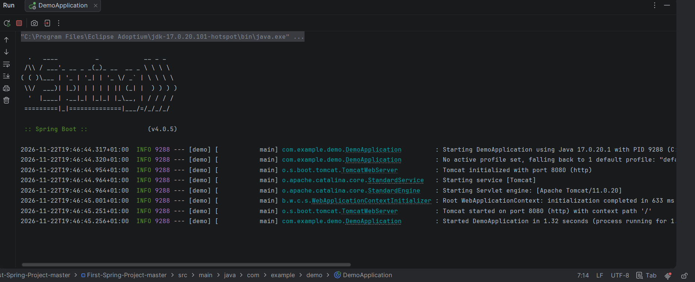
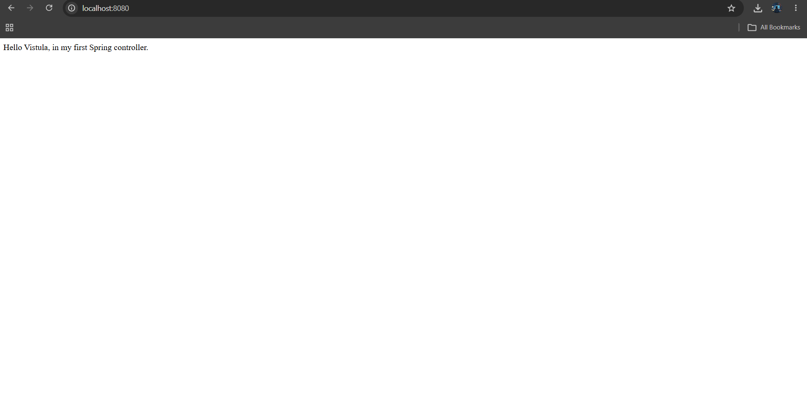
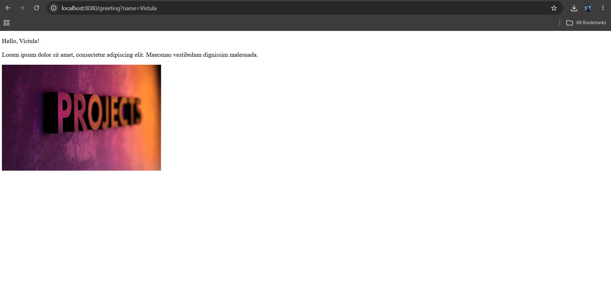

# First Spring Project

Exercise 16 – Task 1: my first Spring Boot application (Spring MVC + Thymeleaf).

## Author

- **Name:** Abdeldjalil Takouche
- **Student ID:** 78469
- **Group:** 1

## Technologies

- Java 17
- Spring Boot 4.0.5
- Maven
- Spring Web MVC
- Thymeleaf
- Lombok

## What the application does

| URL | Description |
|-----|-------------|
| `/` | Returns plain text from the controller (uses `@ResponseBody`). |
| `/greeting` | Returns the `greeting.html` view. Accepts an optional `name` parameter (default value: `World`). |

Example: `http://localhost:8080/greeting?name=Vistula`

## Project structure

```
src/main/java/com/example/demo
├── DemoApplication.java
└── controller
    └── HelloController.java
src/main/resources
├── static
│   └── vistula.png
└── templates
    └── greeting.html
```

## How to run

1. Clone or download the repository.
2. Open the project in IntelliJ IDEA (the folder that contains `pom.xml`).
3. Wait until Maven downloads the dependencies.
4. Run the `DemoApplication` class.
5. Open `http://localhost:8080` in your browser.

You can also run it from the terminal:

```
./mvnw spring-boot:run
```

## Screenshots

### Console output



### Home page (`/`)



### Greeting page (`/greeting?name=Vistula`)


